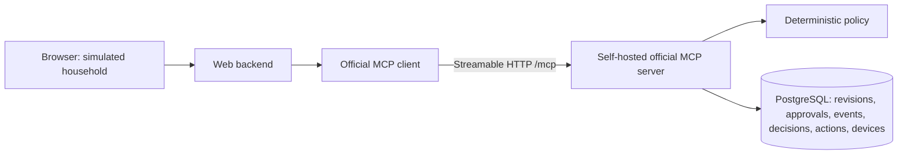

> Continuation 2026-10-22: seeded-draft UI implemented; local browser flow passed.
> Render deployment in progress. See docs/render-deployment.md and verification.md.
> Older deferred-scope/status notes below are historical.

# HomeRelay architecture

Status: backend vertical slice implemented; frontend deferred by the implementation
request. One npm package, TypeScript, two Node processes and PostgreSQL 18.6.
npm scripts use project-local Node 24.22.0; system Node is unchanged.

## Options and decision

| Option | Tradeoff | Decision |
| --- | --- | --- |
| Node web backend + separate HTTP MCP server + PostgreSQL | One language, demonstrable network boundary, few moving parts | Recommended |
| Full-stack framework + separate MCP service | Useful later for a larger UI, adds build/framework surface now | Defer |
| Browser calls MCP directly | Removes backend, moves auth and cross-origin concerns into browser | Reject for first slice |

The browser never contains DB credentials. The web backend owns no DB connection
and imports no policy implementation. Only the MCP service may execute policy or
write domain state. If it is stopped, simulation requests must fail visibly.

## SDK and transport

Registry inspection returned `@modelcontextprotocol/client@2.3.1`,
`@modelcontextprotocol/server@2.3.1`, and `@modelcontextprotocol/node@2.1.1`, each
requiring Node >=20. These versions are installed and pinned in package-lock.json.
The Node adapter declares a server ^2.3.0 peer. A real separate-process test
negotiated MCP 2025-11-25, called a structured tool and rejected invalid arguments.
Use the v2 documentation consistently; do not mix v1 imports.
The official Node adapter avoids adding an HTTP framework just for MCP.

Use the SDK's Client and StreamableHTTPClientTransport for initialization,
tools/list and tools/call. Use McpServer with the official HTTP handler/Node
adapter. The SDK owns serialization, negotiation, validation and lifecycle.
Record the negotiated protocol in test evidence; refuse to claim track compliance
if it predates 2025-11-25. Domain state must not depend on transport sessions.

Loopback defaults: web `127.0.0.1:3000`, MCP `127.0.0.1:3001/mcp`. Validate Host
and Origin, restrict body size to 16 KiB, allow only expected methods and JSON,
and require a per-run server-held bearer secret on MCP requests. Web mutations
require same-origin requests and a CSRF token. Do not bind publicly or enable
wildcard CORS. Public hosting requires a separate authentication/TLS review.

## Application interfaces

| Web route | MCP tool | Contract |
| --- | --- | --- |
| POST /api/approve | approve_routine | `{routineRevisionId, contentHash}` -> persisted approval; stale hash/revision fails |
| POST /api/events | simulate_event | event schema from spec -> `{decision, replayed}` |
| GET /api/decisions/:eventId | get_decision | event ID -> stored decision/evidence, or NOT_FOUND |
| POST /api/proposals (M2) | propose_routine | `{text}` -> draft revision or clarification, no action |
| POST /api/revisions (M2) | revise_routine | `{routineRevisionId, expectedHash, changes}` -> new unapproved revision |

The backend exposes GET /api/routines/:revisionId through the read-only
`get_routine` MCP tool. The initial page is deferred; README provides explicit
operator API calls. No approve-on-start or auto-approve behavior. A retry sends
the same event ID. The server ignores no unknown fields: schema validation rejects
them, including caller-supplied approval, decision, household or policy fields.

Domain responses use structured tool output and a matching output schema. A
Decision contains `decisionId`, `eventId`, `routineRevisionId`, `policyVersion`,
`evaluatedAt`, `eventSnapshot`, `routineSnapshot`, `approvalSnapshot`,
`sunsetSnapshot`, and per-action `{deviceId, action, verdict, reasonCode,
executionStatus, actionId, before, after}`. Denied actions have null actionId and
`not_executed`. Approval snapshots may be null. `replayed` is a response property,
not a modification of the original decision. Explanations format these stored
fields; current rules and current device state must not rewrite the past.

## Durable model

Use SQL migrations and `pg`; no ORM. Tables:

- `routine_revisions`: household, routine ID, revision ID, immutable JSON content,
  content hash, created time; unique routine/revision identity.
- `routine_heads`: household/routine primary key and current revision ID; serialize
  edit/approve/evaluate access by locking this row in the same order.
- `approvals`: unique revision ID, content hash, actor and approved_at; FK revision.
- `events`: primary key `(household_id, event_id)`, validated request JSON and
  payload hash; includes routine revision ID. Reject same key with different data.
- `decisions`: unique event key and decision UUID, policy version and immutable
  evidence JSON; FK event. Includes durable denials.
- `actions`: action UUID, decision FK, ordinal, device/action and before/after;
  unique `(decision_id, ordinal)`. Contains only committed allowed executions.
- `devices`: household/device primary key, simulated state; initial porch off and
  door locked. Door locked is enforced by policy and a database constraint for
  the current demo model.

M1 seeds one draft revision and two simulated devices in an isolated demo DB.
Seed is idempotent and must never reset existing device state, approvals or history.
Test fixtures reset only an explicitly disposable test database/schema.

## Transaction and replay algorithm

1. Validate and normalize the event (including timestamp to UTC), serialize fields
   in a defined order, hash that representation. No Date.now() in the input hash.
2. Begin a PostgreSQL transaction. Insert the event with ON CONFLICT DO NOTHING
   and RETURNING. A unique-key conflict waits for a concurrent writer to finish.
3. If not inserted, read the existing row in a subsequent statement under READ
   COMMITTED. Compare normalized payload hashes. Different input returns
   IDEMPOTENCY_CONFLICT. Identical input returns the existing decision with
   replayed=true, including its old revision/policy evidence.
4. For a new event, lock the routine head; load the revision and approval. Lock
   relevant devices in sorted device-ID order. Load server-owned sunset fixture.
5. Evaluate pure policy with explicit inputs; never execute model-generated code.
6. Insert decision evidence and allowed action rows; update allowed simulated
   devices. Denials insert no action row. Commit all writes together.
7. Respond only after COMMIT. On error roll back, report failure, and let a retry
   use the same event ID. Never run an out-of-transaction simulated device effect.

This gives at-most-one committed simulated action per event/action across races
and process restarts. It does not promise exactly-once external hardware effects.
External devices would require a separately designed delivery/reconciliation model.

## Failure and retrieval behavior

Web maps invalid input to 400, conflicting replay/stale revision to 409, absent
history to 404, unavailable MCP/DB to 503; bounded timeouts return a retriable error.
Policy denial is a successful evaluation response with a denied verdict. MCP
protocol/tool errors remain SDK-managed; the web adapter maps domain errors.
GET history makes no state changes. Missing evidence yields NOT_FOUND, never a
model-generated explanation. Startup health checks DB connectivity and migrations;
no fallback to memory. Close pools, transports and servers on normal shutdown.

## Time Machine continuation (2026-10-23)

Additional read-only/test MCP tools, each with strict Zod input and enveloped output
schemas registered through the official SDK:

| Web route | MCP tool | Contract |
| --- | --- | --- |
| GET /api/incidents/:eventId | reconstruct_incident | stored decision + per-action ordered checks (passed / failed / not_reached) with evidence strings from stored snapshots; NOT_FOUND if never recorded |
| POST /api/preflight | run_preflight | `{routineRevisionId, candidate: {weekdays 0-6, actions?}}` -> saved run with baseline/candidate verdicts for six fixed cases; CSRF + same origin |
| GET /api/preflight/:runId | get_preflight_run | saved run JSON or NOT_FOUND |

`src/preflight.ts` calls the production `evaluate()` with hypothetical events and a
simulated approval (`actor: preflight-simulation`, never written to `approvals`). It
does not call `processEvent()` and opens no transaction on domain tables. Its only
write is one insert into `preflight_runs` (migration 002, additive, insert-only, never
read by event processing). `src/incident.ts` does not re-evaluate. It places the
recorded reason code in `CHECK_ORDER` (exported beside `evaluate()` and pinned to it by
a unit test). Checks before the failure are implied passed by policy precedence, and
checks after it are not reached. The browser contains no policy logic. It displays
server results.

`migrate()` now applies an ordered, checksummed list under the same advisory lock.
MCP startup requires the latest schema version and refuses to listen otherwise.
`db/*.sql` is pinned to LF in `.gitattributes` because checksums hash the file text.
